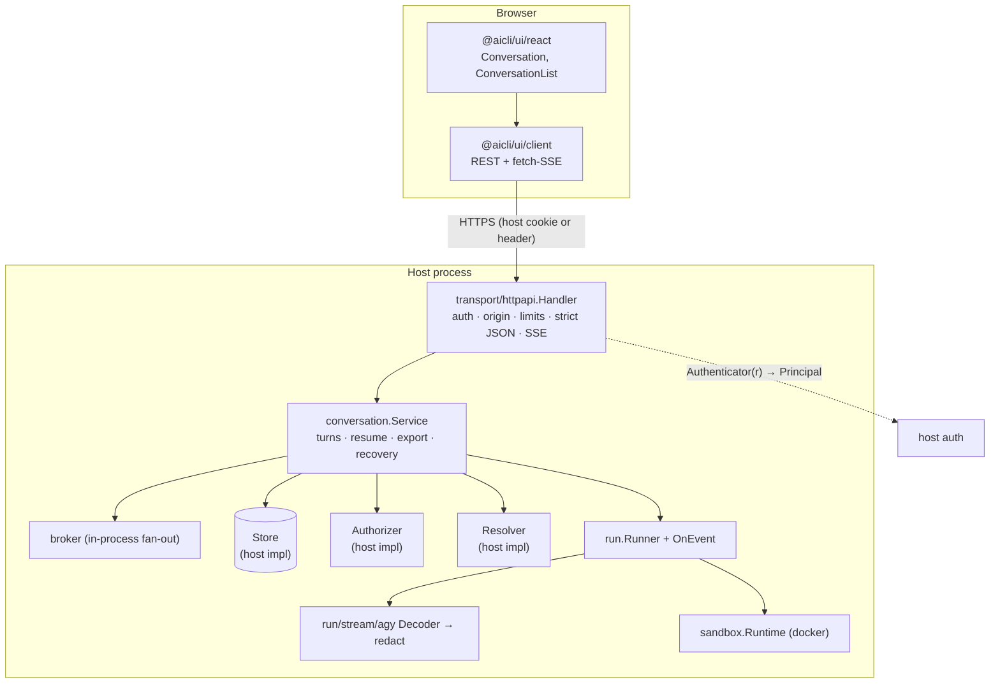

# Design: Conversation UI

## Key Decisions

- **Decision:** Execution parameters come only from a host-side `Resolver`.
  **Reason:** The browser is untrusted. If any request field could flow into `run.Request` beyond the prompt and an allowlisted profile name, the HTTP API becomes a remote-exec endpoint.
- **Decision:** `Store.ClaimTurn` is the single concurrency primitive.
  **Reason:** An in-memory mutex is wrong as soon as there are two backend instances. Pushing the atomic claim into the host's store (a conditional insert/update in their DB) is correct everywhere and keeps aicli database-agnostic.
- **Decision:** Persist events first, then fan out.
  **Reason:** Replay after reconnect, history, export and multi-instance followers all read the same log. Live delivery is only an optimization over polling that log.
- **Decision:** Redact at the decoder boundary, per complete line.
  **Reason:** Redacting raw chunks misses secrets split across reads. The decoder already works line by line, so redaction applied to each decoded event sees whole values.
- **Decision:** Stream via `fetch` with the host's own credentials.
  **Reason:** One consumer forbids tokens in URLs and already reads SSE with `fetch`; the other uses cookies. `fetch` covers both, so there is no second auth mechanism (tickets) to secure.
- **Decision:** `run/stream` holds `Event` and `Decoder`.
  **Reason:** `run` must call decoders and decoders must produce events. Putting the types in `run` and decoders in `run/stream/<cli>` would make the decoder sub-packages import `run` while `run` imports them: a cycle.

- **Decision (Phase 1, recorded 2026-10-29): use agy `stream-json`, not the json fallback.**
  **Reason:** Recorded on agy 1.4.8 (fixtures in `run/stream/agy/testdata/`). Output is NDJSON with three event kinds:
  - `{"event":"init","conversation_id":…,"init":{cwd,tools[],permission_mode}}`: first line.
  - `{"event":"step_update","step_update":{conversation_id,step_index,state:"ACTIVE"|"DONE",step_type,…}}`: `step_type` is `user_input`, `agent_response` (carries `text_delta`, whose last `DONE` delta is `"\n"`, plus `usage` and `duration_seconds` on `DONE`) or `tool` (`tool_name`, `tool_info{name,parameters,output}`; `ACTIVE` when started, `DONE` with `output` when finished).
  - `{"event":"result","result":{conversation_id,status:"SUCCESS",response,duration_seconds,num_turns,usage}}`: last line.
  Text arrives as true deltas, so it streams. Tool parameters carry absolute paths and file content may appear in `output`; both are truncated and redacted before they reach a client.
- **Decision (Phase 1): a resume with an unknown conversation ID is detected by comparing IDs, not by exit code.**
  **Reason:** agy exits 0, prints `warning: conversation "<id>" not found` on stderr, and silently starts a new conversation with a different ID. If the `result.conversation_id` differs from the one requested, the turn is `session_expired` (conversation `resumable = false`) and the new ID is discarded. Matching the stderr warning is only a secondary signal because its wording may change.
- **Decision (Phase 1): `run.ParseTelemetry` is not used to get the conversation ID.**
  **Reason:** it reads top-level `conversation_id`/`session_id`, but agy nests the ID (`result.conversation_id`, `step_update.conversation_id`). The agy decoder reads it itself; telemetry is unchanged.

## Approach

Each user message is one headless CLI run inside the existing sandbox, resumed from the previous run's CLI session. `run.Runner` gains a streaming hook. The runtime tees container stdout into a line splitter; each line goes to the profile's decoder, then redaction, then `Request.OnEvent`. `conversation.Service` owns turn lifecycle: claim, resolve, run, persist events, finish. `transport/httpapi` is a thin `net/http` layer: authenticate, check origin and limits, decode strict JSON, call the service, serialize DTOs, and serve SSE from the store plus an in-process broker. The npm package wraps the HTTP contract in a framework-free client and React components.

Login stays on `capture` (PTY + WebSocket + ticket) because it truly needs an interactive terminal; chat never does.

## Alternatives Considered

- **Web terminal for chat (PTY over WebSocket, xterm.js).** Rejected. Users type straight into a CLI running with permissions bypassed, which leaves the sandbox as the only defense. Raw bytes can't be redacted reliably, and the history is unstructured.
- **WebSocket transport.** Rejected for MVP. SSE plus POST covers send, stream and cancel; both consumers already run SSE in production; and it needs no new Go dependency.
- **Stream tickets in the query string.** Rejected. One consumer forbids URL tokens, and `fetch`-based SSE makes them unnecessary.
- **aicli-owned database (SQLite).** Rejected. It conflicts with "host owns storage", and hosts already have a database.
- **Event sourcing framework / message broker.** Rejected as speculative. An append-only table behind `Store` is enough.
- **Web Components (Lit).** Deferred. Both consumers are React 19, and the framework-free client keeps the door open.
- **One long-lived agy process per conversation (`--input-format stream-json` over stdin).** Rejected. It pins a conversation to one instance and one container, wastes resources while the conversation is idle, and turns crash recovery into process supervision.
- **`tsup` for the build.** Rejected. Its README says it is no longer actively maintained and points to `tsdown`.

## Architecture



Package dependencies (arrows point to the imported package):

```
transport/httpapi → conversation → run → run/stream ← run/stream/agy
                                  ↘ run/stream/agy       run → sandbox, profile, rules
```

## Interfaces & Contracts

Illustrative Go shapes; names are final, field details may change during Phase 2 review.

```go
package conversation

type Principal string // opaque host identity

type Action string // "create" | "read" | "send" | "cancel" | "export" | "list"

type Authorizer interface {
    // conversation is nil for create and list.
    Authorize(ctx context.Context, p Principal, a Action, c *Conversation) error // nil = allowed
}

type Resolver interface {
    // Resolve returns the base run request for one turn. The service overwrites
    // Profile, Command, Args, Prompt, ResumeSessionID and OnEvent.
    Resolve(ctx context.Context, p Principal, c Conversation) (run.Request, error)
    // SaveCredentials persists credential files the CLI refreshed during a turn
    // (run.Result.UpdatedCredentialFiles, keyed like CredentialFiles). Called only when
    // non-empty, before FinishTurn, so the next Resolve returns the fresh token.
    SaveCredentials(ctx context.Context, p Principal, c Conversation, files map[string]string) error
}

type Store interface {
    CreateConversation(ctx context.Context, c Conversation) error
    GetConversation(ctx context.Context, id string) (Conversation, error) // ErrNotFound
    ListConversations(ctx context.Context, owner Principal, cursor string, limit int) ([]Conversation, string, error)

    // ClaimTurn atomically records t as running and sets the conversation's ActiveTurnID.
    // ErrTurnInProgress if there is one; the stored turn with ErrDuplicate if t.ClientMessageID
    // was used before (checked first, so a retry is idempotent even while the turn runs).
    ClaimTurn(ctx context.Context, t Turn) (Turn, error)
    GetTurn(ctx context.Context, id string) (Turn, error)
    RenewLease(ctx context.Context, turnID string, until time.Time) error
    // RequestCancel marks a running turn (idempotent); ErrTurnNotRunning once it finished.
    RequestCancel(ctx context.Context, turnID string) error
    CancelRequested(ctx context.Context, turnIDs []string) ([]string, error)
    // FinishTurn stores the final turn, clears ActiveTurnID, sets Resumable, and replaces the
    // stored CLI session ID when sessionID is not empty. Atomic.
    FinishTurn(ctx context.Context, t Turn, sessionID string, resumable bool) error
    StaleTurns(ctx context.Context, now time.Time) ([]Turn, error)

    // AppendEvents assigns consecutive Seq values per conversation, atomically.
    AppendEvents(ctx context.Context, conversationID string, ev []Event) ([]Event, error)
    ListEvents(ctx context.Context, conversationID string, afterSeq int64, limit int) ([]Event, error)
}

type Config struct {
    Runner     *run.Runner
    Store      Store
    Authorizer Authorizer // nil → DenyAll; OwnerOnly is provided for the common case
    Resolver   Resolver
    Profiles   []string   // allowlist; every entry must support streaming
    Logger     *slog.Logger
    LeaseDuration, CancelPoll, EventPoll, ReauthInterval time.Duration // 2m, 2s, 1s, 60s
    MaxMessageBytes, MaxTitleRunes, MaxActiveTurns, MaxExportEvents int // 32KiB, 255, 2, 100000
    Now   func() time.Time
    NewID func() (string, error) // tests; default 128 random bits, URL-safe
}

func NewService(cfg Config) (*Service, error)
func (s *Service) Create(ctx, p, profile, title string) (Conversation, error)
func (s *Service) Send(ctx, p, conversationID, message, clientMessageID string) (t Turn, duplicate bool, err error)
func (s *Service) Cancel(ctx, p, conversationID, turnID string) error
func (s *Service) Get(ctx, p, id) (Conversation, error)
func (s *Service) List(ctx, p, cursor string, limit int) ([]Conversation, string, error)
func (s *Service) Events(ctx, p, id string, afterSeq int64, limit int) ([]Event, error)
func (s *Service) Export(ctx, p, id, format, turnID string) (Exported, error)
func (s *Service) Subscribe(ctx, p, conversationID string, afterSeq int64) (<-chan Event, error)
func (s *Service) RecoverStale(ctx context.Context) (int, error)
func (s *Service) Close(ctx context.Context) error // interrupts running turns, waits
```

**Subscribe handover (replay → live, no gap, no duplicate).** The live source is registered before the store is read, and the stored maximum is used as a watermark:

1. Register a buffered subscription on the in-process broker for the conversation. Events published from now on queue up in it.
2. `ListEvents(id, afterSeq)` page by page until a page comes back short. Emit each event and set `last = event.seq`.
3. Drain the broker queue, dropping every event with `seq <= last`. After that, forward live events, still dropping `seq <= last`, and advance `last` each time.
4. If an event arrives with `seq > last + 1` (a gap: another instance is running the turn, or the subscriber's buffer overflowed), read `ListEvents(id, last)` from the store to fill it before forwarding.
5. While the conversation has a turn running on another instance, poll `ListEvents(id, last)` every `EventPoll`. The same dedupe applies.

Broker buffers are bounded (default 256 events). An overflow does not block the publisher: it marks the subscriber "lagging", and step 4 then catches it up from the store. Because `seq` is assigned by `AppendEvents` and the broker publishes only after the append returns, `seq` is the single ordering key.

**Cross-instance cancel.** Each instance keeps a map of `turnID → cancel func` for the turns it runs. `Cancel` calls `Store.RequestCancel`, then calls the local cancel func if there is one. Each running turn has a watcher that, every `CancelPoll`, asks `CancelRequested([turnID])` and cancels on a hit (and renews the lease every `LeaseDuration/4`). This costs one cheap store query per running turn per tick and needs no broker.

**Lag signal.** When the broker has to drop an event for a slow subscriber it also signals that subscriber, which then catches up from the store immediately. Without it, a subscriber whose last events were all dropped would wait for the next poll.

```go
package run/stream

type Kind string // user.message, turn.started, assistant.text, tool.use, tool.result,
                 // turn.completed, turn.failed, turn.cancelled

type Event struct {
    Kind Kind
    Text string            // assistant.text, user.message
    Tool *Tool             // tool.use / tool.result: Name, Summary (truncated), IsError
    Meta map[string]string // whitelisted scalar metadata only (e.g. usage tokens)
    SessionID string       // set by decoder on the result line; never leaves the server
}

type Decoder interface { Decode(line []byte) ([]Event, error) }
```

Small additions to existing packages:
- `sandbox.CommandRequest.Output io.Writer`: an optional tee of stdout. The docker runtime writes to it from the same `stdcopy` loop it already uses for activity detection. `sandboxmock` writes scripted stdout to it, and `StubRuntime` writes its fixed output.
- `profile.Profile.StreamArgs []string`: the output-format flags for streaming. For `antigravity` and `antigravity_notools` this is `--output-format stream-json`. A nil value means the profile cannot stream. The Phase 1 fallback sets it to nil.
- `profile.StreamingArgs(ref string, args []string) ([]string, error)`: returns `args` with the `--output-format <fmt>` pair replaced in place by the profile's `StreamArgs` (appended if absent), or `ErrStreamingUnsupported` when the profile has no `StreamArgs`. In-place replacement is what keeps agy's `-p <prompt>` pair intact, for both `antigravity` (pair after `-p`) and `antigravity_notools` (pair before `-p`). It takes the caller's `args` because `run.Request.Args` comes from the host, not from the profile. `run` applies it, then appends `ResumeArgs`, then `ExtraArgs`.
- The agy decoder takes the conversation ID from `init.conversation_id` and `result.conversation_id` (nested, unlike what `run.ParseTelemetry` reads), emits `assistant.text` from `agent_response` `text_delta`s, `tool.use` / `tool.result` from `tool` steps, and usage from `result.usage`.
- `run.Request.OnEvent func(stream.Event)`: when set, `Run` applies `StreamingArgs`, tees stdout through a line splitter and the profile's decoder, and passes redacted events on. Assistant text is held until a line break and redacted per complete line (a secret cut across deltas is still caught); a 16 KiB hold limit flushes a long line in pieces, keeping a 1 KiB tail. Events passed to `OnEvent` never carry the session ID; `Result.SessionID` does. Lines the decoder rejects are counted in `Result.SkippedLines`. Decoders are chosen by profile ref inside `run` (`antigravity*` → `run/stream/agy`).

HTTP contract (prefix chosen by the host):

| Method & path | Body / query | Success |
|---|---|---|
| `POST /conversations` | `{profile, title?}` | `201 Conversation` |
| `GET /conversations` | `?cursor` (opaque) `&limit` (1–100, default 20) | `200 {items, nextCursor}` |
| `GET /conversations/{id}` | | `200 Conversation` |
| `POST /conversations/{id}/messages` | `{message ≤32 KiB, clientMessageId ^[A-Za-z0-9_-]{1,64}$}` | `202 {turnId}` / `200` on duplicate |
| `POST /conversations/{id}/turns/{turnId}/cancel` | | `202` (also on repeat) |
| `GET /conversations/{id}/events` | `?after` (≥0, default 0) `&limit` (1–500, default 200) | `200 {items}` |
| `GET /conversations/{id}/stream` | header `Last-Event-ID` (≥0) | `200 text/event-stream`, open across turns |
| `GET /conversations/{id}/export` | `?format=md\|json&turnId?` | `200` attachment, fetched by the client and saved as a Blob |

`POST /conversations` takes `{profile, title?}`, with `title` at most 255 runes.

Errors use `{"error": {"code": "...", "message": "..."}}`. The codes are `unknown_field`, `invalid_field`, `invalid_query`, `unsupported_media_type`, `profile_not_allowed`, `turn_in_progress`, `turn_not_running`, `not_resumable`, `message_too_large`, `rate_limited`, `not_found`, `forbidden`, `unauthenticated`, `origin_not_allowed`, and `internal`. Messages for `internal` never include error details. A turn's failure codes are a separate set, carried in `turn.failed` events and the turn DTO rather than HTTP errors: `quota_exceeded`, `auth_invalid`, `awaiting_input`, `session_expired`, `interrupted`, and `run_failed`.

```go
package httpapi

type Config struct {
    Service        *conversation.Service
    Authenticate   func(*http.Request) (conversation.Principal, error) // required
    AllowedOrigins []string
    AllowNoOrigin  bool
    MaxBodyBytes   int64 // default 64 KiB
    MaxMessage     int   // default 32 KiB
    SendRate       rate  // default 10/min per principal
    MaxActiveTurns int   // default 2 per principal
}
func NewHandler(cfg Config) (http.Handler, error)
```

TypeScript client:

```ts
createClient({
  baseUrl: string,
  getHeaders?: () => Promise<Record<string,string>> | Record<string,string>,
  credentials?: RequestCredentials,     // "include" for cookie hosts
  fetch?: typeof fetch,                 // testing / custom transports
})
// conversations.create/list/get, messages.send, turns.cancel, events.list,
// exportBlob(id, format) → Blob (fetch with auth; UI saves via URL.createObjectURL),
// stream(id, {lastEventId, signal, onEvent}): one long-lived stream per open conversation,
// backoff reconnect from the highest seq seen
```

`<Conversation>` opens the stream when it mounts and closes it on unmount or when `id` changes. `messages.send` never touches the stream. The Send button stays disabled until the first stream connection succeeds, so an event cannot be produced before anyone is listening. Replay covers the case anyway.

React components: `<AicliProvider client>`, `<ConversationList onSelect>`, `<Conversation id>`. The building blocks `MessageList`, `MessageInput`, `TurnStatus` and `ExportMenu` are exported too. Every component file starts with `"use client"`, and nothing touches `window` at import time, because both consumers use Next.js.

## Security Boundaries

| Boundary | Control |
|---|---|
| Browser → handler | Host `Authenticate` on every request. Origin allowlist: POSTs must carry an allowed `Origin`; GETs are checked when `Origin` is present (browsers omit it on same-origin GET) and when `Sec-Fetch-Site: cross-site`. Body size cap. `DisallowUnknownFields`. Bounded query and field values. Rate and concurrency limits per principal. |
| Handler → service | Principal and an allowlisted profile name are the only inputs besides the message text. |
| Service → store/authorizer | `Authorize` runs before every read or write. Denials for ID-addressed resources return not-found. The authorizer is re-checked periodically on long streams. |
| Service → runner | The base request comes from `Resolver` (trusted). The prompt goes through `promptFileInstruction` as a file, never argv. The existing `sandbox` mount policy and no-HOME rule apply. Refreshed credentials go back only through `Resolver.SaveCredentials`; they are never stored as events and never logged. |
| Runner → client | Decoder → redact → truncate, then store, then send. The agy conversation ID is stripped from client DTOs. |
| UI render | Text nodes only. No HTML from output. Links are not auto-linked in MVP. |

## Performance Considerations

- **Expected throughput:** tens of concurrent conversations per instance. Runs are minutes long, and the CLI is the bottleneck.
- **Latency budget:** each decoded event reaches subscribers on the same instance within 100 ms of the line being written. Other instances get it within 1 s through polling.
- **Caching:** none. Event pages are read straight from the store, using an index on `(conversation_id, seq)`; the integration guide asks hosts to add it.
- **Known bottlenecks:** `AppendEvents` per decoded line. Events are batched every 100 ms or 32 events, whichever comes first (`writer` in turn.go).

## Observability

### Metrics

Recorded through an OpenTelemetry meter the host injects (`go.opentelemetry.io/otel` is already a module dependency). If no meter is given, the no-op meter is used:
- `aicli.conversation.turns` (counter): by profile and outcome (completed, failed:code, cancelled).
- `aicli.conversation.turn.duration` (histogram).
- `aicli.conversation.stream.subscribers` (gauge).
- `aicli.stream.decode.skipped` (counter): by profile.
- `aicli.httpapi.rejected` (counter): by code.

### Logging

Logs go through the injected `*slog.Logger`, and message text and output are never logged.
- INFO: audit records `action`, `principal`, `conversation_id`, `turn_id` and `outcome`.
- WARN: denials, rate limits, stale-turn recovery.
- ERROR: store failures and runner errors, with error codes only.

### Tracing

Span `conversation.send`, with child spans `conversation.resolve`, `run.Run` and `conversation.persist`.

## Risks

- **agy's stream-json format is undocumented and changes between versions.** Mitigation: golden NDJSON fixtures recorded from the real binary (with the agy version in the file name), a decoder that tolerates unknown types, the turn outcome still decided by `run.Result`, and the json fallback (see proposal).
- **agy resume depends on more than `SessionDir`**, such as the project ID or the absolute workspace path. Mitigation: a Phase 1 test resumes in a fresh container. If it fails, `Resolver` must pin the extra state, and that becomes part of its contract.
- **The build drops the `"use client"` directives.** Mitigation: an unbundled build plus a post-build check (see tasks).
- **Host `ClaimTurn` is not actually atomic.** Mitigation: a contract test suite (`conversation/storetest`) that host implementations run, including a concurrent claim test. memstore is the reference.
- **SessionDir is not on shared storage in multi-instance deployments**, so resume fails. Mitigation: it degrades to `session_expired` with history intact, and the integration guide documents the requirement.
- **Secrets the redaction patterns don't cover reach the browser.** Mitigation: same exposure as the logs today, with the same patterns. Tool payloads are truncated, and hosts can extend the patterns.
- **Long-lived streams hold connections.** Mitigation: heartbeats, the stream closes on idle, and a per-principal stream cap (default 5).
