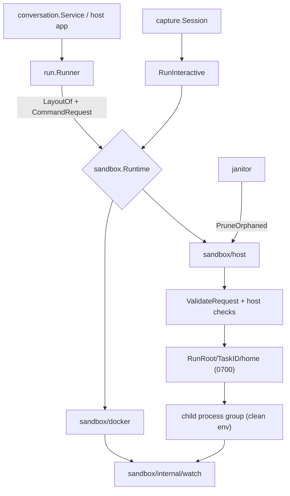

# Design: Host process runtime

## Key Decisions
- **Decision:** Callers ask the runtime for paths (`sandbox.LayoutOf`) instead of using
  `/workspace` and `sandbox.HomeDir` directly.
- **Reason:** Those paths are baked into shell scripts, prompt sentences, env values and mount
  keys; only the code that builds them can substitute them safely.

- **Decision:** The tool guardrail reads a marker from aicli's profile registry, carried on the
  request by `run.Runner`, and an operator-only config switch.
- **Reason:** The runtime cannot tell from a `bash -lc` script whether tools are enabled, and no
  value a client controls may decide it.

- **Decision:** Refuse unsupported isolation fields instead of ignoring them.
- **Reason:** A caller asking for `NetworkModeNone` or read-only mounts relies on them; silently
  running without them is a security downgrade.

## Approach

```go
// sandbox/layout.go

// WorkspaceDir is where container runtimes mount CommandRequest.Workspace.
const WorkspaceDir = "/workspace"

// Layout is where a runtime places a request's workspace and HOME, as the process sees them.
type Layout struct {
	Workspace string
	Home      string
}

// ContainerLayout is the layout of container runtimes such as sandbox/docker.
// A function, not a package var, per the no-global-state rule.
func ContainerLayout() Layout { return Layout{Workspace: WorkspaceDir, Home: HomeDir} }

// LayoutProvider is implemented by runtimes whose processes do not see the container layout.
type LayoutProvider interface {
	Layout(req CommandRequest) (Layout, error)
}

// LayoutOf returns rt's layout for req, or ContainerLayout when rt does not provide one.
func LayoutOf(rt Runtime, req CommandRequest) (Layout, error)
```

Caller changes, all mechanical replacements of a constant with a layout field:

| Where | Today | After |
|---|---|---|
| `run.Run` | `containerRoot` default work dir, `hostPath` maps `/workspace/...` | `layout.Workspace`; `hostPath` maps from `layout.Workspace` (identity on host) |
| `run.sessionLayout` | `p.Env(sandbox.HomeDir)`, mount keys `HomeDir/<dir>` | `p.Env(layout.Home)`, `layout.Home/<dir>` |
| `run.credentialTargets`, `relativeToHome`, `withDefaults`, `Preflight` | `sandbox.HomeDir` | `layout.Home` |
| `run.Run`, `Preflight` | — | set `CommandRequest.Profile` when args are the registry's |
| `capture.RunWith` | `HOME=/workspace` | `HOME=layout.Workspace`; merge `profile.Env(layout.Workspace)` when `Session.Profile` is set |
| `toolchain.Runtime`, `sandbox.Manager` | — | `Layout` delegates to inner |

`run` computes the layout once per call from a request with `TaskID` and `Workspace` filled, and
passes it to the helpers.

### Host runtime

File split, so the package builds everywhere: `config.go` (no tag) holds `Config`, the sentinel
errors and the `Runtime` type's exported surface; `host.go`, `env.go`, `interactive.go`,
`prune.go` are `//go:build linux || darwin`; `host_other.go` is `//go:build !linux && !darwin` and
makes `New` return `ErrUnsupportedOS`. `doc.go` has no tag.

```go
// sandbox/host/config.go
type Config struct {
	RunRoot             string     // per-run dirs; default <os.TempDir()>/aicli-host. Must not cover HOME.
	WorkspaceRoot       string     // used when a request has no Workspace
	AllowedRoots        []string   // optional; resolved workspace and session sources must lie inside one
	PATH                string     // default "/usr/local/bin:/usr/bin:/bin"
	AllowTools          bool       // run profiles without NoTools; no isolation, trusted setups only
	InteractiveCommands [][]string // exact argv RunInteractive may start
	Logger              *slog.Logger
}

func New(cfg Config) (*Runtime, error)
```

`Run(ctx, req)`:
1. `layout := r.Layout(req)` — validates `TaskID` (plain name), resolves the workspace.
2. `sandbox.ValidateRequest(req, sandbox.NetworkModeBridge)`, then host checks in this order:
   unsupported fields → tool guardrail → mount/credential targets inside `layout.Home` →
   nested session mounts → `EvalSymlinks` of workspace and session sources (not covering HOME,
   inside `AllowedRoots` when set; created when missing, then required to be directories). Session links are created from the
   *resolved* paths, so a source swapped for a symlink between check and use points nowhere new.
3. `os.Mkdir(<RunRoot>/<TaskID>, 0o700)` (fails if it exists), then `home/`, `tmp/`; `defer
   os.RemoveAll`.
4. Session mounts → `os.Symlink(hostDir, target)` after `MkdirAll` of the target's parent;
   credential files → mode `0600`, written by temp file + rename (`writeFileReplacing`), so a
   symlink at the target is replaced, not followed.
5. The command is looked up in `Config.PATH` (not the server's) and started with `exec.Cmd`: `Dir = layout.Workspace`, `Env = buildEnv(req, layout, cfg)`,
   `SysProcAttr{Setpgid: true}`, `WaitDelay` a few seconds. A goroutine sends
   `syscall.Kill(-pid, SIGKILL)` when the context ends; the same kill runs once more after `Wait`
   so helpers left behind do not outlive the run.
6. stdout → `MultiWriter(buffer, logFile, watch.Activity, req.Output)`, stderr → `MultiWriter(buffer,
   logFile, watch.Activity)`; the watchdog goroutine kills the group on idle/loop and records the
   reason.
7. After `Wait`: for each session link, `Lstat` it and compare `Readlink` with the resolved
   source; any mismatch → `ErrSessionDetached`. Then read each credential file and include it in
   `UpdatedCredentialFiles` only if it differs from `req.CredentialFiles[target]` (a missing or
   unreadable file is skipped, as in the Docker runtime). Build `CommandResult`.

`RunInteractive` follows steps 1–5 with the allowlist check in place of the tool guardrail,
starts the command with `pty.StartWithSize` (which sets `Setsid` and `Setctty` on `SysProcAttr`;
the runtime sets neither `Setpgid` nor anything else there, because `setpgid` on a session leader
fails with `EPERM`), kills with `syscall.Kill(-pid, SIGKILL)` (a setsid child has pgid == pid),
copies stdin → pty and pty → stdout, applies
`ResizeCh` with `pty.Setsize`, and waits.

`PruneOrphaned(ctx, minAge)` removes entries under `RunRoot` older than `minAge`, using the same
safety checks as `sandbox` janitor roots (`ErrUnsafeRoot`).

`Prewarm` does nothing and returns nil.

## Alternatives Considered
- **Prefix rewriting inside the host runtime.** No caller change, but it must rewrite `/workspace`
  inside a `bash -lc` script and inside the prompt sentence, and cannot tell a path from text
  that happens to contain it. Rejected.
- **bubblewrap / user namespaces.** Real `/workspace` and `/home/agent`, plus network and mount
  isolation. Needs unprivileged user namespaces (usually off in PaaS containers, the main target)
  and is Linux-only. Kept as a possible separate runtime.
- **Copying session state in and out instead of symlinks.** Safe against a CLI that replaces the
  link, but slower and loses writes on a crash. Rejected; the symlink stays, and a replaced link is
  detected after the run and reported as `ErrSessionDetached` instead of losing state silently.
- **`script -qfc` for the PTY.** No dependency, but flags differ between util-linux and BSD, and
  resizing is not possible. Rejected in favor of `creack/pty`.

## Architecture


## Interfaces & Contracts
- `CommandRequest.Profile`: built-in profile ref, set by `run.Runner` only when argv comes
  unmodified from the registry. Runtimes other than `sandbox/host` ignore it.
- `profile.Profile.NoTools`: true only when the profile's args disable every tool and every
  permission bypass. `profile_test.go` already checks those args for the two `_notools` profiles;
  the test also asserts the marker.
- Errors: `host.ErrToolsNotAllowed`, `host.ErrNotAllowlisted`, `host.ErrUnsupported`, all
  sentinel errors wrapped with the offending profile/field/argv.
- `capture.Session.Profile`: optional profile ref whose `StateEnv` is resolved against the session
  HOME; `Session.Env` still overrides.

## Security Boundaries
- **What the runtime guarantees:** the child gets a private HOME and TMPDIR, an environment with
  nothing from the server, no write by the runtime outside the run directory, process-group
  cleanup, the same command policy as Docker, and refusal of every isolation field it cannot
  honor.
- **What it does not:** file-system, network, uid or resource isolation. The child can read
  whatever the server uid can read (including `~/.ssh` of that uid). The deployment guide must
  say: run the server under a dedicated uid with nothing sensitive in its HOME, allowlist only
  `_notools` profiles in `conversation`, and use the Docker runtime for anything with tools.
- **Who decides:** `AllowTools` and `InteractiveCommands` are server config. Clients choose only a
  profile name from the server's allowlist; the `NoTools` marker comes from aicli's registry.
- **Leftover secrets:** run directories are `0700` and credential files `0600`; normal exits,
  errors and kills remove them; crashes are cleaned by `PruneOrphaned`.

## Performance Considerations
- **Latency budget:** runtime overhead (validation, mkdir, symlinks, fork/exec of `bash -lc`)
  under 50 ms p50 on Linux; `BenchmarkHostRun` runs `true` to measure it.
- **Throughput:** bounded by the CLI and the host app's concurrency limits (`conversation`
  already caps runs per principal); the runtime adds no shared lock.
- **Caching:** none.
- **Known bottlenecks:** `bash -l` reads `/etc/profile`; acceptable, and the same as the container.

## Observability

### Metrics
No new metrics; `run/telemetry.go` spans and attributes apply unchanged. Add attribute
`aicli.runtime = "host" | "docker"` if telemetry already tags the runtime.

### Logging
- WARN once in `New` when `AllowTools` is true.
- INFO on refusal: reason (`tools_not_allowed`, `not_allowlisted`, `unsupported:<field>`), task ID,
  profile. Never argv, env values or credentials.
- WARN when cleanup of a run directory fails.

### Tracing
N/A beyond the existing `run` spans.

## Risks
- **A `_notools` profile is not as tool-less as believed** (CLI changes its flags). Mitigation:
  the profile tests pin the flags; the toolchain pins CLI versions; docs say it is defense in
  depth.
- **A host application builds `CommandRequest` itself with `Profile` set.** The marker is only as
  trustworthy as server-side code. Mitigation: documented; `run.Runner` is the supported path.
- **The CLI replaces the session symlink.** Detected after the run (`ErrSessionDetached`); the
  turn fails and the operator sees which path. If a real CLI is found to do this, the fix is a
  per-profile copy-back, not a silent default.
- **A session or workspace directory contains links to sensitive places.** Not policed (same uid);
  `AllowedRoots` limits where the directories themselves may live, and the deployment guide says
  to use a dedicated uid.
- **macOS PTY or process-group differences.** Mitigation: host tests run on macOS in CI if a
  runner exists, otherwise documented as best-effort.
